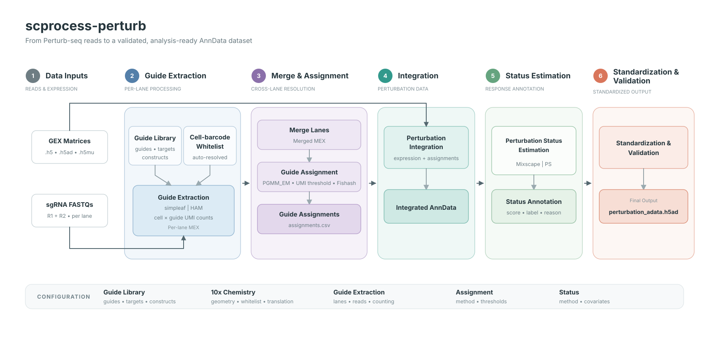

# scprocess-perturb

## A single-cell perturbation screen preprocessing workflow

`scprocess-perturb` processes Perturb-seq guide FASTQs together with a gene
expression matrix and produces a validated, analysis-ready AnnData dataset. The
workflow covers Guide Extraction, Guide Assignment, Perturbation Integration,
Perturbation Status Estimation, and Data Standardization and Validation.
The thesis-release version is `v1.0.0`.

## Workflow overview



The workflow covers guide input, per-lane quantification, assignment,
expression integration, perturbation-status estimation, and final validation.
It can also stop at an earlier target.

## Main output

A complete run writes one primary dataset and its companion provenance record:

```text
{out_dir}/final/
├── perturbation_adata.h5ad
└── provenance.yaml
```

The H5AD contains expression, counts, source metadata, guide candidates,
construct annotations, assignment structure, and a fixed status interface.
`provenance.yaml` records the workflow version, parameters, environments,
inputs, operations, matrix semantics, validation, and output metadata.

## Quick start

```bash
git clone https://github.com/yunzhe-liu/scprocess-perturb.git
cd scprocess-perturb

conda env create -f envs/scp_analysis.lock.yaml
conda activate scp_analysis

# Edit config/config.yaml and config/groups.yaml, then run:
snakemake --use-conda --conda-frontend conda \
  --configfile config/config.yaml --cores 48
```

Run the bundled end-to-end smoke test with:

```bash
conda run -n scp_analysis python tests/smoke_test.py
```

The default template uses `simpleaf` for guide extraction, `pgmm_em` for guide
assignment, `dual` guide design, and `none` for Perturbation Status Estimation.
For a complete run, configure exactly one assignment method. To compare multiple
assignment methods, run the workflow separately for each method.

## Required inputs

| Input | Format | Purpose |
|---|---|---|
| sgRNA reads | Paired FASTQ, R1 + R2, per lane | Guide extraction |
| Gene expression matrix | `.h5`, `.h5ad`, or `.h5mu`, per lane | Cell universe, expression, and barcode whitelist |
| Guide library | CSV | Guide reference generation and guide-to-target/construct mapping |

Each physical 10x lane is declared in `config/groups.yaml`:

```yaml
groups:
  lane_01:
    group_id: lane_01
    gex_h5: /path/to/expression.h5ad
    sgRNA_fastq_dir: /path/to/sgRNA_fastq/
    sgRNA_r1_pattern: "*_R1_001.fastq.gz"
    sgRNA_r2_pattern: "*_R2_001.fastq.gz"
```

The workflow derives guide references and chemistry-specific resources under
`{out_dir}/refs/`. See [Chemistry configuration](docs/chemistry.md) for supported
10x chemistries, whitelist handling, barcode translation, and custom layouts.

## Minimal configuration

```yaml
proj_dir: /path/to/scprocess-perturb
out_dir: /path/to/results
log_dir: /path/to/logs
groups_file: config/groups.yaml

tenx_chemistry: "3v3"
guide_csv: /path/to/guide_library.csv

guide_extraction:
  method: simpleaf                  # simpleaf | hash_matcher

simpleaf:
  af_home: ""                       # optional; defaults to the rule Conda environment

assignment:
  guide_design: dual                # single | dual | multi
  methods:
    - pgmm_em                       # pgmm_em | umi_threshold | fishash

perturbation_status:
  method: none                      # none | mixscape | ps
  feature_mode: auto                # auto | gene | usa_sa
```

`assignment.methods` must contain exactly one method for a complete run. Remove
the entire `assignment` section, or leave `methods` empty, only when the intended
output is the merged guide-count matrix without integration.

## Workflow stages

### 1. Guide Extraction

Guide extraction quantifies guide UMIs independently for each lane. Two engines
are supported:

| Method | Description |
|---|---|
| `simpleaf` | piscem indexing followed by alevin-fry quantification and UMI resolution |
| `hash_matcher` | HAM exact/hash-based guide matching with configurable barcode error tolerance |

The expression matrix normally supplies the cell barcode whitelist. Simpleaf
can instead use UMI-knee cell calling; HAM requires a whitelist.

### 2. Lane merge

Per-lane guide matrices are concatenated and cell barcodes receive `-L{NN}`
lane suffixes. The merged Matrix Market output uses cells × guides orientation,
not the conventional 10x features × cells orientation.

### 3. Guide Assignment

Assignment identifies valid guide candidates for every cell. Select one method
per complete workflow run:

| Method | Assignment rule | Main score |
|---|---|---|
| `pgmm_em` | Per-guide Poisson-Gaussian mixture model | `prob_gaussian` |
| `umi_threshold` | Fixed UMI threshold | `umi_count` |
| `fishash` | Fisher-test-based assignment with FDR control | `negative_log_pval` |

All methods produce the same candidate schema. `score` always increases with
assignment evidence; `native_score` preserves the method's original statistic:

```text
cell_barcode, guide_id, umi_count, rank, score, score_type, method,
native_score, native_score_type
```

The canonical assignment result is:

```text
{out_dir}/assignment/{method}/assignments.csv
```

It retains every candidate that passes the selected method's filter and is the
input to perturbation integration. `perturbation_obs.csv` is an additional
per-cell summary produced according to `guide_design`; it is not the primary
integration input.

The canonical guide-library schema is a long table:

```text
construct_id,guide_id,guide_sequence,target_label,guide_position
```

`guide_sequence` is required when the workflow builds a guide reference from
FASTQs. It may be omitted when starting from assignment or integration.
`construct_id` is required for dual and multi designs; `guide_position` is
optional. Legacy `guide_id,gene[,construct_id]` tables and dual-guide wide
tables using `sgID_A/sgID_B` remain accepted and are normalized internally.

Method parameters and intermediate assignment outputs are documented in
[Workflow details](docs/workflow-details.md#guide-assignment-details).

### 4. Perturbation Integration

Integration combines the selected `assignments.csv` with the expression matrix
and source metadata:

```text
{out_dir}/integration/perturbation_adata.h5ad
```

It uses all valid assignment candidates rather than top-1 alone. `top_guide`
is retained for traceability, while guide and construct counts determine
`assignment_structure`:

| Value | Definition |
|---|---|
| `single_guide` | Exactly one valid guide |
| `concordant_construct` | Multiple valid guides mapping to one construct |
| `mixed_construct` | Multiple valid guides mapping to different constructs |

For a `single` guide design, a cell with multiple valid guides is classified as
`mixed_construct`. Dual and multi designs require a guide-to-construct library.
Expression cells without a valid assignment are excluded from the integration
output. Their number, together with assignment rows lacking an expression cell,
is reported in the integration log and provenance metadata.

#### Expression contract

```text
.X                    normalized, log-transformed expression
.layers["counts"]     original integer-valued counts
```

Existing counts layers are retained. Integer `.X` is treated as counts and
normalized with log1p CP10K; normalized inputs must provide aligned counts.
Ambiguous floating-point matrices are rejected unless explicitly declared as
counts. The output records whether normalization was computed or inherited.

The integration H5AD is an intermediate standard input for status estimation
and the final validation stage; it is not the primary workflow deliverable.

### 5. Perturbation Status Estimation

Mixscape and PS are alternative status-estimation methods. The default
`method: none` skips model computation while preserving the same status columns
in the final H5AD. Mixscape additionally requires `perturbation_type` to be
`KO`, `CRISPRa`, or `CRISPRi`.

Mixscape and PS operate on `single_guide` and `concordant_construct` cells and
retain the eligible non-targeting control pool. `mixed_construct` cells remain
in the AnnData but are not status-eligible.

Status estimation does not alter the integration or final expression matrices.

### 6. Data Standardization and Validation

The final stage validates the expression contract, status coverage, required
metadata, and output readability, then writes:

```text
{out_dir}/final/perturbation_adata.h5ad
```

It does not recompute normalization, filter observations or variables, or alter
their order. `.X` and `layers["counts"]` are verified after writing; validation
details are written to `{log_dir}/finalization/finalization.log`.

## Final AnnData contract

| Location | Contents |
|---|---|
| `.X` | Normalized, log-transformed expression inherited from integration |
| `.layers["counts"]` | Aligned original integer counts |
| `.obs` | Source metadata, assignment annotations, construct/target labels, and status fields |
| `.var` | Expression-feature metadata |
| `.obsm["guide_candidates"]` | Sparse matrix of all valid guide candidates and canonical scores |
| `.obsm["construct_candidates"]` | Construct-level candidate scores when a construct library is available |
| `.uns` | Candidate labels, expression contract, and workflow provenance |

The status interface is always present:

```text
perturbation_status_method
perturbation_status_score
perturbation_status_label
perturbation_status_scorable
perturbation_status_reason
```

When `method: none`, method is `none`, score and label are missing, scorable is
`False`, and reason is `not_run`. With Mixscape or PS, every status-eligible cell
must have exactly one status record. Noneligible cells are retained with reason
`not_eligible`.

Detailed metadata fields and method-specific behavior are documented in
[Workflow details](docs/workflow-details.md).

## Running selected stages

Stop after guide extraction and merge:

```bash
snakemake --use-conda --conda-frontend conda --cores 48 \
  /path/to/results/guide_matrix/merged_matrix.mtx.gz
```

Stop after perturbation integration:

```bash
snakemake --use-conda --conda-frontend conda --cores 8 \
  /path/to/results/integration/perturbation_adata.h5ad
```

## Output structure

```text
{out_dir}/
├── refs/                             generated references and cached whitelists
├── lanes/                            per-lane guide quantification
├── guide_matrix/                     merged cells × guides Matrix Market trio
├── assignment/{method}/
│   ├── assignments.csv               canonical assignment candidates
│   └── perturbation_obs.csv          auxiliary per-cell summary
├── integration/
│   └── perturbation_adata.h5ad        integrated intermediate AnnData
├── perturbation_status/{method}/     present for Mixscape or PS
└── final/
    ├── perturbation_adata.h5ad        primary workflow output
    └── provenance.yaml                compact traceability record
```

Run logs are written under `{log_dir}` by workflow stage.

## Additional documentation

- [Chemistry configuration](docs/chemistry.md): supported 10x chemistries,
  geometry, whitelists, translation, overrides, and custom chemistry.
- [Workflow details](docs/workflow-details.md): method parameters,
  intermediate outputs, environments, rule sequence, repository layout, and
  implementation notes.
